<p align="center">
  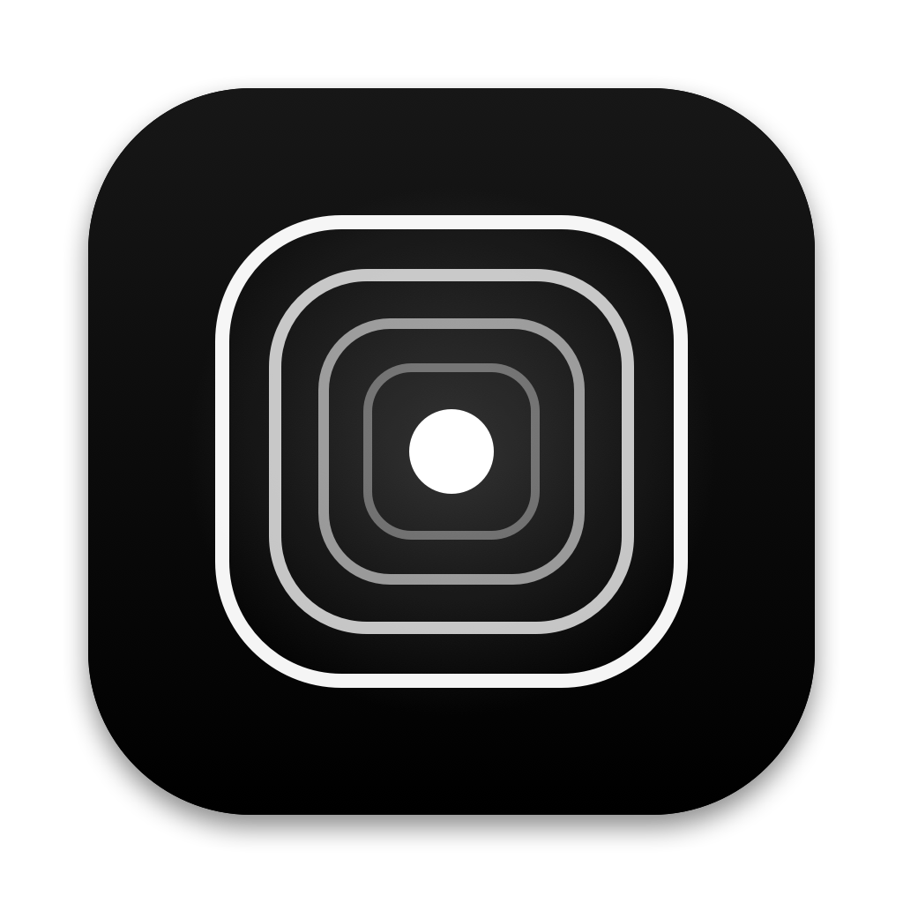
</p>

<h1 align="center">Houra for Linux</h1>

<p align="center">
  <b>A calm focus timer for the Linux desktop.</b><br>
  Plan the session, keep the time in sight, and step away from the screen when the break comes.
</p>

<p align="center">
  <b>English</b> · <a href="README.tr.md">Türkçe</a>
</p>

<p align="center">
  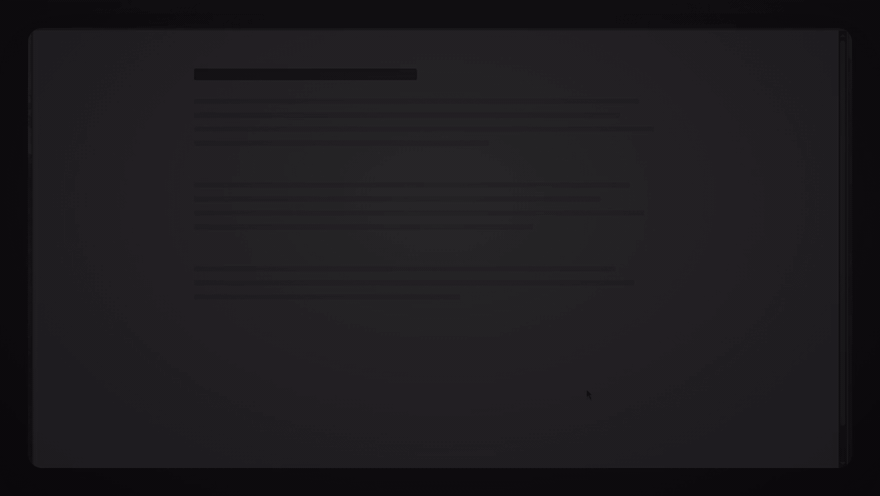
</p>

---

This is the Linux version of Houra. For the macOS version, see [**Houra**](https://github.com/serbestonline/Houra) by Emirhan (`@serbestonline`); both use the same SQLite data format.

Houra is built around three ideas:

1. **Decide before you start.** Every session begins with a category, a goal and, if you want, a short task list. Once the session runs, the list is locked: you finish what you planned instead of adding more.
2. **Keep time in sight without a window in the way.** A small tag, strip, capsule, card or ring sits on your screen. Everything around it stays click-through.
3. **Really take the break.** When the time is up, a full-screen break covers every display. It only lets you back in early through a deliberate, press-and-hold *Emergency* button.

Everything stays on your machine in a local SQLite file. There is no account and no tracking; Todoist is optional and off by default. The interface is available in English and Turkish.

> This repository used to be the Omarchy plugin. That plugin is no longer maintained; its last state is on the [`omarchy`](https://github.com/fatihaydost/houra-linux/tree/omarchy) branch.

## Install

Download `houra.flatpak` from the [latest release](https://github.com/fatihaydost/houra-linux/releases/latest), then:

```sh
flatpak install --user houra.flatpak
flatpak run io.github.fatihaydost.Houra
```

Houra lives in the tray. The first start asks your desktop to register global shortcuts for a new session (`Ctrl+Alt+N`) and the panel.

The Flatpak has access to your home folder so it can read a weekly note wherever you keep it, and shares its data with a source install at the paths under [Your data](#your-data). Run only one of them at a time.

### Desktop support

| Desktop | On-screen view and break | Status |
|---|---|---|
| KDE Plasma (Wayland) | Layer shell | Tested |
| Hyprland, Sway, niri, COSMIC | Layer shell | Should work, not tested yet |
| GNOME, X11 sessions | Plain always-on-top window | Should work, not tested yet |

The tray needs a StatusNotifierItem host: KDE has one, Waybar works, GNOME needs the AppIndicator extension. *Do Not Disturb during focus* needs a notification server with inhibition (KDE); the setting hides itself elsewhere.

## Sessions

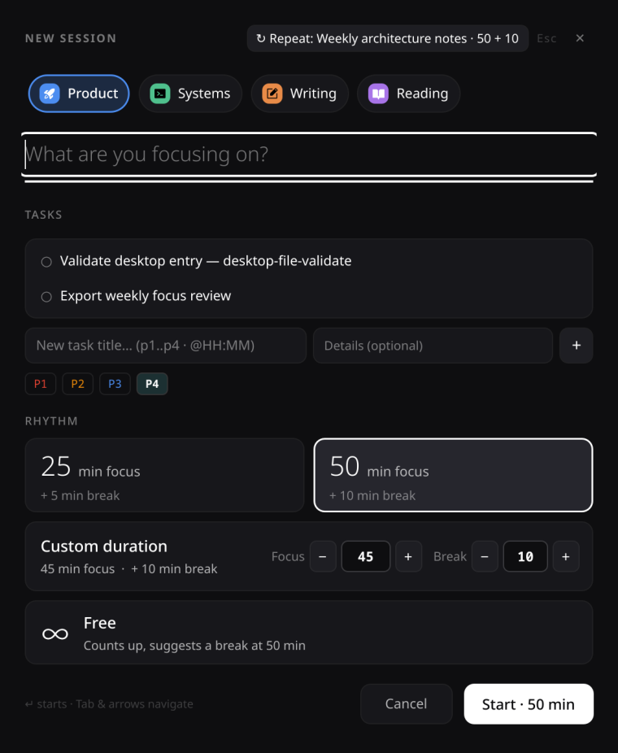

Start a session from the tray, the panel or a global shortcut.

- **Category:** each has its own colour and, optionally, an emoji or one of 100 built-in icons.
- **Goal:** answer *What are you focusing on?* in a few words.
- **Tasks:** tick tasks from today's list, or write new ones with a `P1–P4` priority and a time (`p1`, `@14:30` work inline).
- **This week's list:** if you plan your week in a Markdown file, Houra reads its open tasks. Set the path in *Settings › Weekly tasks*; it can contain the year, week and month (`{YYYY}`, `{WW}`, `{MM}`). Houra never writes to your notes.
- **Rhythm:** 25 + 5, 50 + 10, a custom length, or free: the clock counts up and suggests a break at 50 minutes.

Each session has a notes field. Notes and tasks stay with the session and show up later in *Sessions*.

<br clear="right">

## On-screen views

<p align="center">
  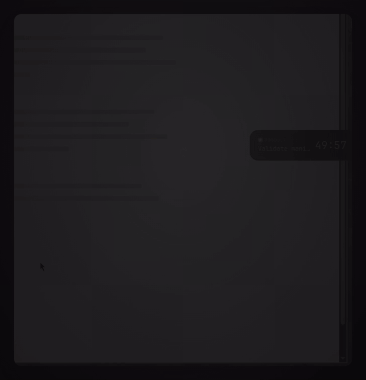
</p>

While a session runs, Houra shows the remaining time in one of five views: **tag**, **thin strip**, **capsule**, **card** or **ring**. Pick one in *Settings* or from the tray menu. Click a view for the countdown, *Pause*, *Finish*, your tasks and notes. Press and drag to move it, including onto another monitor.

<p align="center">
  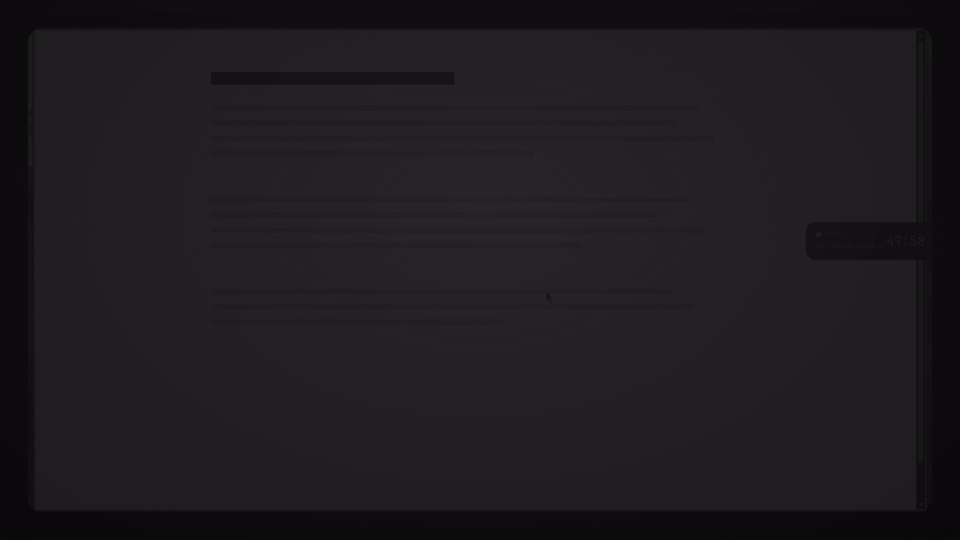
</p>

## Break screen

<p align="center">
  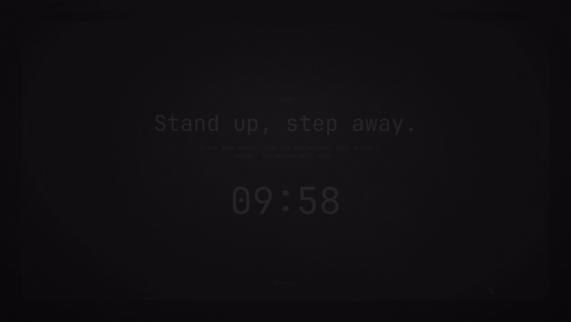
</p>

When the focus time ends, or when you press *Finish*, a slow black-and-white scene covers every screen. If something really cannot wait, **press and hold *Emergency* for 1.5 seconds**. The early exit is recorded.

## Statistics

<p align="center">
  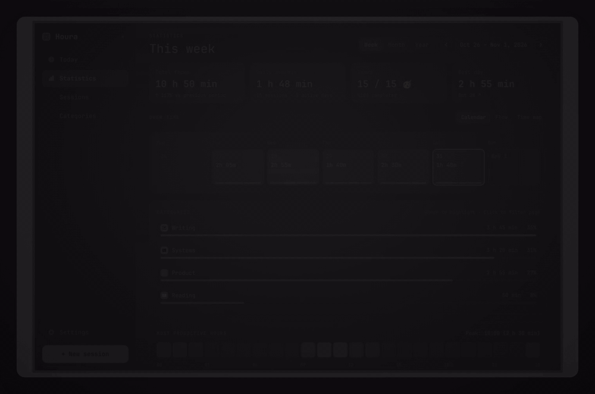
</p>

Look at a week, a month, a year or any range: total focus, daily average, finished tasks and your best day; a calendar, a flow chart and a time map; your most productive hours; and the details of any day.

## Today, history and settings

<p align="center">
  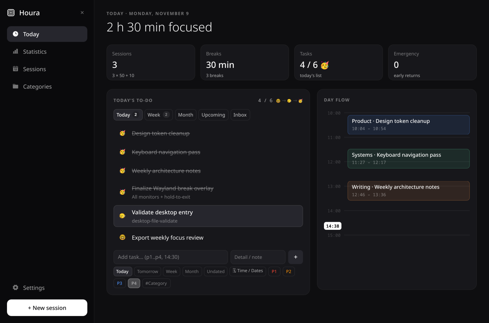
</p>

<p align="center">
  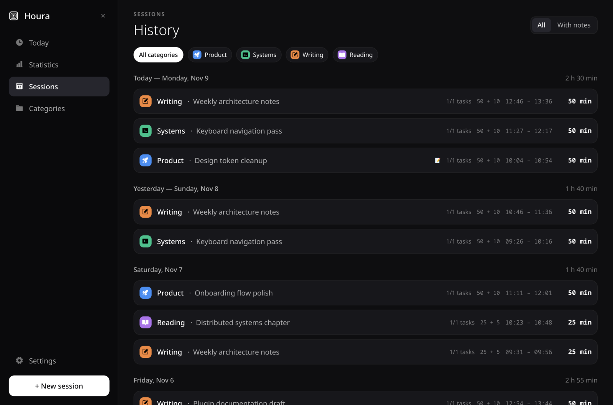
  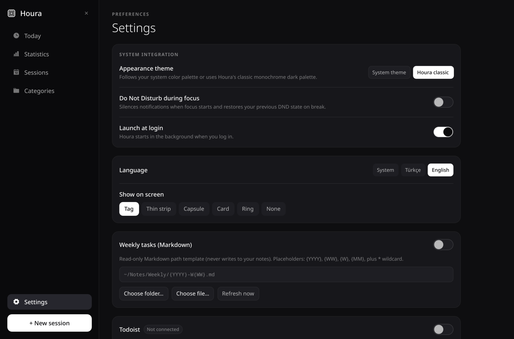
</p>

*Today* holds your to-do planner and a timeline of the day. *Sessions* is your history by day, filterable by category or by notes. *Settings* covers the appearance (your system theme or *Houra classic*), language, on-screen view, launch at login, weekly tasks, Todoist and your data.

## Todoist

<p align="center">
  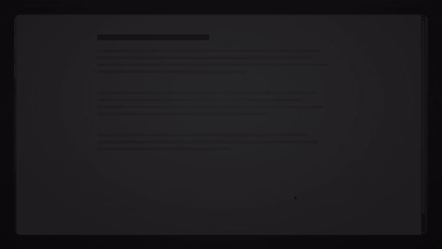
</p>

Optional and off by default. Paste a personal API token from Todoist's website (*Settings › Integrations › Developer*) into *Settings › Todoist*. Houra lists your Todoist tasks next to your own, lets you pick them in a new session, and can create or edit them. Finishing a session never completes a Todoist task by itself.

## Commands and keyboard

A running Houra accepts commands, so you can bind them to shortcuts on any desktop. With the Flatpak, replace `houra` with `flatpak run io.github.fatihaydost.Houra`.

```
houra newSession | panel | stats | tab <today|stats|sessions|categories|settings> | close | toggle | pause | finish
      closeSession | cancel | syncTodoist | style <tag|strip|capsule|card|ring|none> | status
```

`houra status` prints the current state as JSON.

Inside Houra, `Tab` and the arrow keys move around, `Enter` or `Space` selects, `Delete` deletes the selected item and `Esc` steps back and then closes the window.

## Your data

- Sessions, tasks and categories: `~/.local/share/houra/houra.sqlite`
- Settings: `~/.config/houra/settings.json`
- The Todoist token only: `~/.local/state/houra/todoist_token` (0600), never on a command line

Nothing leaves your machine unless you connect Todoist. *Settings* can open the data folder or export every session as CSV.

## Building from source

Build the Flatpak:

```sh
flatpak remote-add --user --if-not-exists flathub https://dl.flathub.org/repo/flathub.flatpakrepo
flatpak-builder --user --install --force-clean --install-deps-from=flathub \
  --state-dir ~/.cache/houra-fpbuild/state ~/.cache/houra-fpbuild/build io.github.fatihaydost.Houra.yml
```

Keep the build directory off a tmpfs: `flatpak-builder` fails there with "Can't migrate locale dirs". An AUR recipe is in [`packaging/aur`](packaging/aur).

To run without packaging you need Python 3.11+, the **system** PySide6 and Qt 6 (Arch: `pyside6`; Debian/Ubuntu: `python3-pyside6.*`; Fedora: `python3-pyside6`) and `layer-shell-qt` 6. The PySide6 wheel from pip bundles its own Qt and cannot load the system layer-shell module.

```sh
python3 -m houra
python3 -m houra --login on   # start at login; `off` removes it
```

Tests:

```sh
python3 houra/backend/houra_cli.py --selftest
python3 -m unittest discover tests
QT_QPA_PLATFORM=offscreen python3 -m houra --smoke
```

Screenshots and clips come from the app itself on sample data. The clips were recorded on an earlier build, so colours and the font can differ slightly from what you see.

## Credits

- macOS version, original concept and design: [**Houra**](https://github.com/serbestonline/Houra) by [Emirhan (`@serbestonline`)](https://github.com/serbestonline). This port is based on its MIT-licensed releases.
- App icon: from the macOS version of Houra.
- Icons: [Phosphor Icons](https://phosphoricons.com) (MIT).
- Linux version by [Fatih Aydost (`@fatihaydost`)](https://github.com/fatihaydost).

## License

MIT, see [`LICENSE`](LICENSE).
