<p align="center">
  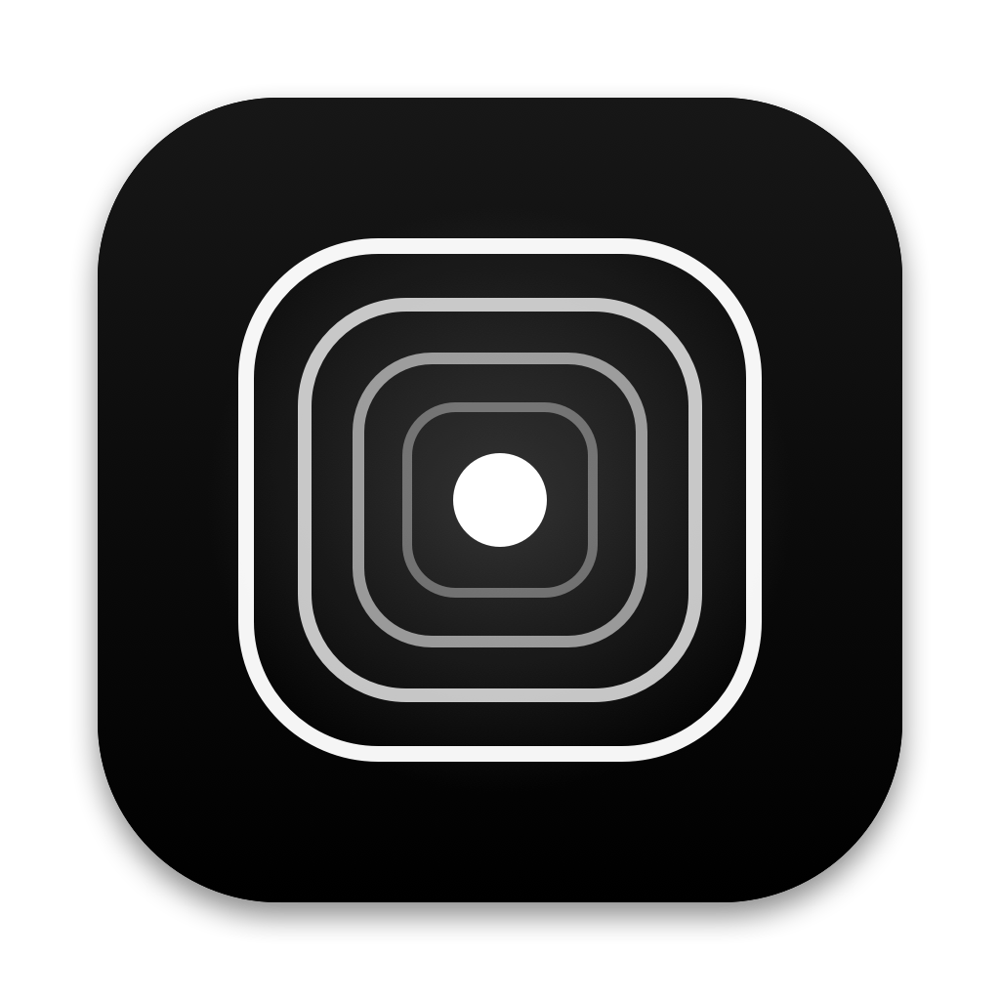
</p>

<h1 align="center">Linux için Houra</h1>

<p align="center">
  <b>Linux masaüstü için sakin bir odak zamanlayıcısı.</b><br>
  Oturumu planla, süreyi gözünün önünde tut, mola gelince ekrandan kalk.
</p>

<p align="center">
  <a href="README.md">English</a> · <b>Türkçe</b>
</p>

<p align="center">
  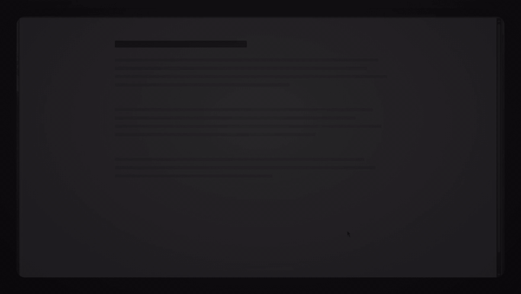
</p>

---

Bu, Houra'nın Linux sürümü. macOS sürümü için Emirhan'ın (`@serbestonline`) [**Houra**](https://github.com/serbestonline/Houra) uygulamasına bakın; ikisi aynı SQLite veri biçimini kullanır.

Houra üç fikir üstüne kurulu:

1. **Başlamadan karar ver.** Her oturum bir kategori, bir hedef ve istersen kısa bir görev listesiyle başlar. Oturum başlayınca liste kilitlenir, yeni iş eklemek yerine planladığını bitirirsin.
2. **Süre görünsün, pencere yolunu kesmesin.** Ekranda küçük bir etiket, şerit, kapsül, kart ya da halka durur. Çevresine tıklamalar alttaki pencereye geçer.
3. **Molayı gerçekten yap.** Süre dolunca bütün ekranları tam ekran mola kaplar. Erken dönmenin tek yolu *Acil durum* düğmesine basılı tutmaktır.

Her şey makinende, tek bir SQLite dosyasında durur. Hesap ve izleme yok; Todoist isteğe bağlı ve varsayılan olarak kapalı. Arayüz Türkçe ve İngilizce.

> Bu repo eskiden Omarchy eklentisiydi. Eklentinin bakımı yapılmıyor, son hâli [`omarchy`](https://github.com/fatihaydost/houra-linux/tree/omarchy) dalında.

## Kurulum

[Son sürümden](https://github.com/fatihaydost/houra-linux/releases/latest) `houra.flatpak` dosyasını indirin, sonra:

```sh
flatpak install --user houra.flatpak
flatpak run io.github.fatihaydost.Houra
```

Houra tepside yaşar. İlk açılışta masaüstü, yeni oturum (`Ctrl+Alt+N`) ve panel kısayollarını kaydetmek için onay ister.

Haftalık notu nerede tutarsanız tutun okuyabilmesi için Flatpak ev klasörünüze erişir. Kaynaktan kurulan sürümle aynı veri dosyalarını kullanır ([Verileriniz](#verileriniz)), ikisini aynı anda çalıştırmayın.

### Masaüstü desteği

| Masaüstü | Ekran sayacı ve mola | Durum |
|---|---|---|
| KDE Plasma (Wayland) | Layer shell | Denendi |
| Hyprland, Sway, niri, COSMIC | Layer shell | Çalışması bekleniyor, henüz denenmedi |
| GNOME, X11 oturumları | Hep üstte duran düz pencere | Çalışması bekleniyor, henüz denenmedi |

Tepsi için StatusNotifierItem desteği gerekir: KDE'de hazır, Waybar'da çalışır, GNOME'da AppIndicator eklentisi ister. *Odak sırasında Rahatsız Etme* için bildirimleri engelleyebilen bir sunucu gerekir (KDE); başka yerde bu ayar görünmez.

## Oturumlar

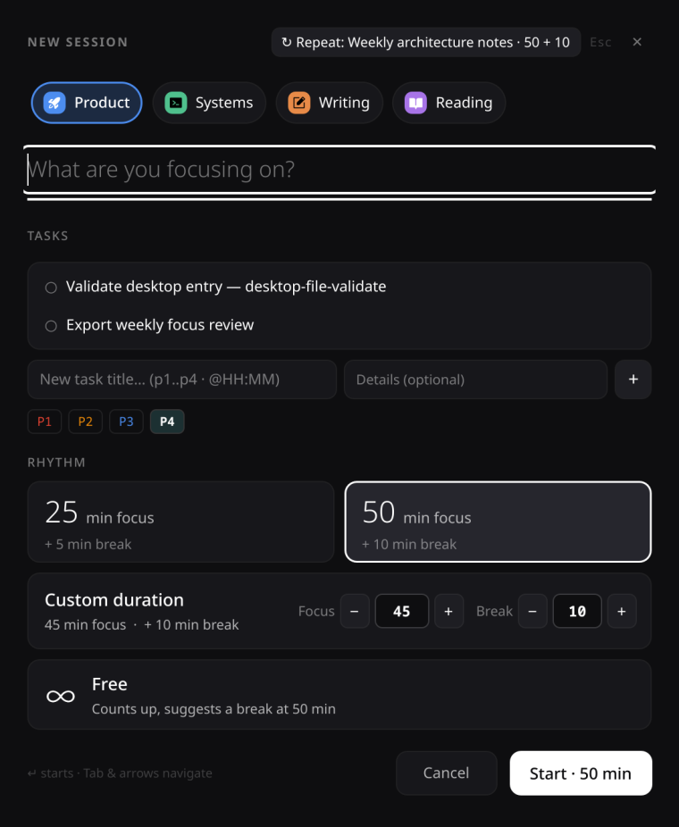

Oturumu tepsiden, panelden ya da genel kısayolla başlatın.

- **Kategori:** her birinin kendi rengi, isterseniz emojisi ya da 100 hazır simgeden biri olur.
- **Hedef:** *Neye odaklanıyorsun?* sorusunu birkaç kelimeyle yanıtlayın.
- **Görevler:** bugünün listesinden seçin ya da `P1–P4` önceliği ve saatle yenisini yazın (`p1`, `@14:30` satır içinde çalışır).
- **Bu haftanın listesi:** haftanızı bir Markdown dosyasında planlıyorsanız Houra açık görevleri okur. Yolu *Ayarlar › Haftalık görevler* altından verin; yıl, hafta ve ay içerebilir (`{YYYY}`, `{WW}`, `{MM}`). Notlarınıza hiç yazmaz.
- **Ritim:** 25 + 5, 50 + 10, özel süre ya da serbest: serbestte sayaç ileri sayar, 50. dakikada mola önerir.

Her oturumun bir not alanı var. Notlar ve görevler oturumla kalır, sonra *Oturumlar* sayfasında görünür.

<br clear="right">

## Ekran sayacı

<p align="center">
  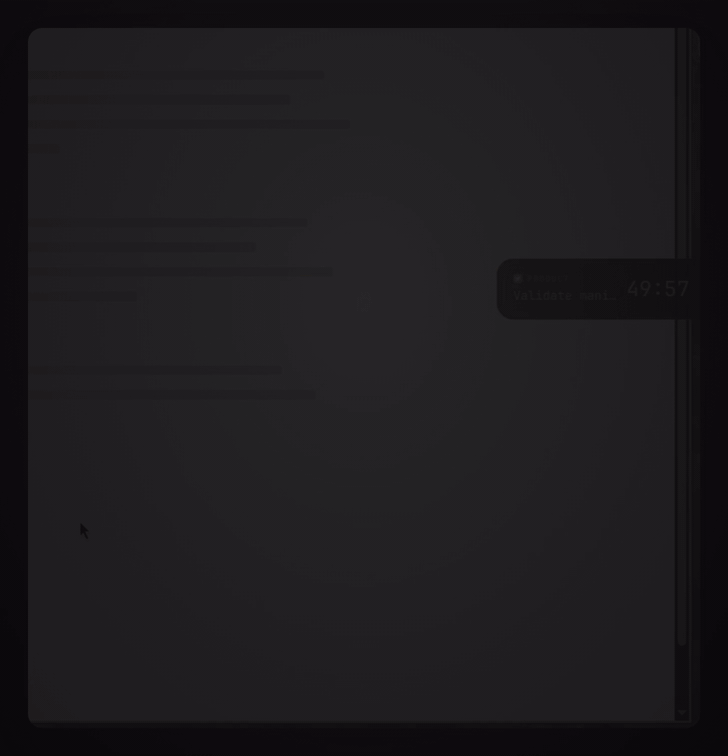
</p>

Oturum sürerken kalan zaman beş görünümden birinde durur: **etiket**, **ince şerit**, **kapsül**, **kart** ya da **halka**. Seçimi *Ayarlar*'dan veya tepsi menüsünden yapın. Görünüme tıklayınca geri sayım, *Duraklat*, *Bitir*, görevler ve notlar açılır. Basılı tutup sürükleyerek başka bir monitöre de taşıyabilirsiniz.

<p align="center">
  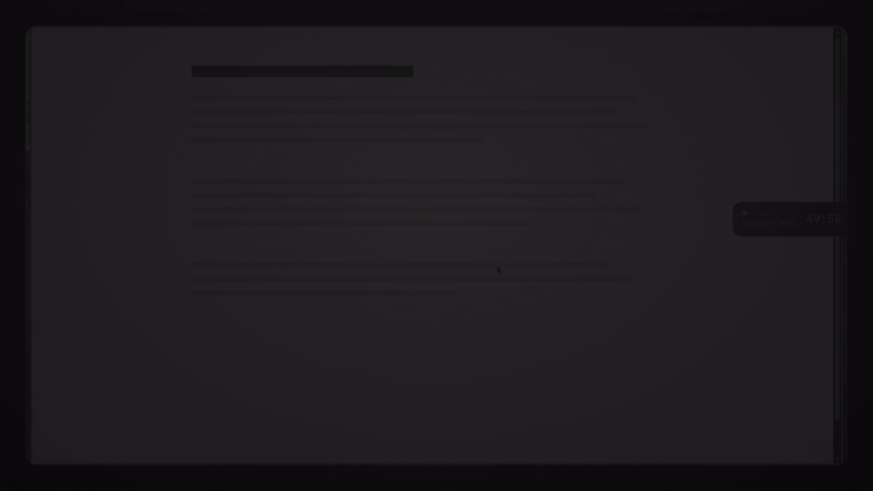
</p>

## Mola ekranı

<p align="center">
  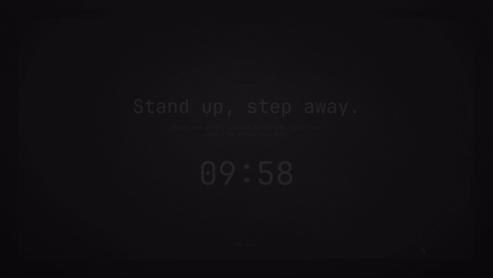
</p>

Odak süresi dolunca ya da *Bitir*'e basınca yavaş akan siyah beyaz bir sahne bütün ekranları kaplar. İş gerçekten bekleyemiyorsa ***Acil durum* düğmesine 1,5 saniye basılı tutun**. Erken çıkış kaydedilir.

## İstatistikler

<p align="center">
  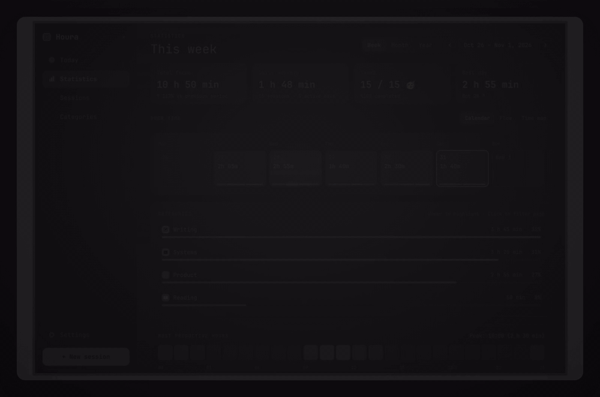
</p>

Haftaya, aya, yıla ya da seçtiğiniz bir aralığa bakın: toplam odak, günlük ortalama, biten görevler ve en iyi gün; takvim, akış grafiği ve zaman haritası; en verimli saatler ve her günün ayrıntısı.

## Bugün, geçmiş ve ayarlar

<p align="center">
  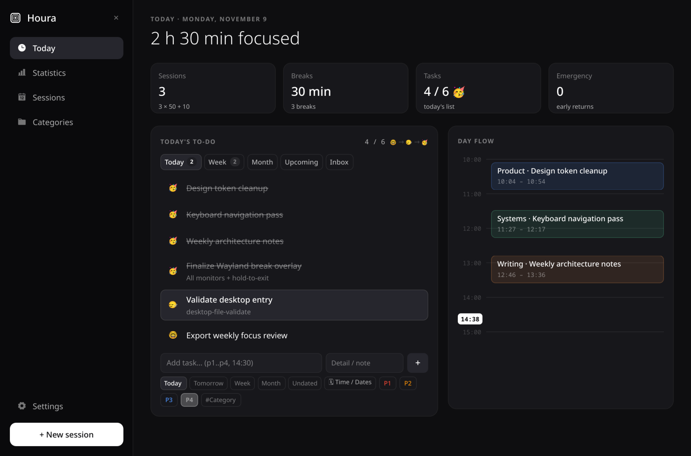
</p>

<p align="center">
  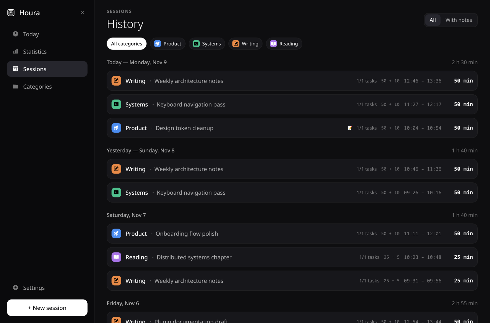
  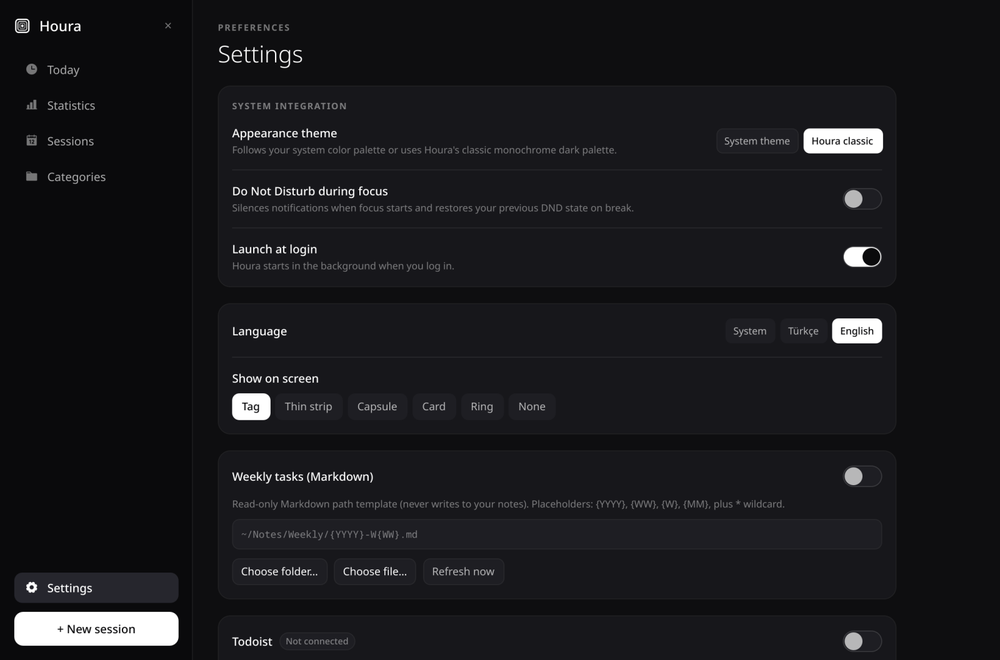
</p>

*Bugün* sayfasında görev planlayıcı ve günün zaman çizelgesi var. *Oturumlar* geçmişinizi güne göre listeler, kategoriye ya da nota göre süzer. *Ayarlar*'da görünüm (sistem teması ya da *Houra klasik*), dil, ekran sayacı, girişte başlatma, haftalık görevler, Todoist ve verileriniz yer alır.

## Todoist

<p align="center">
  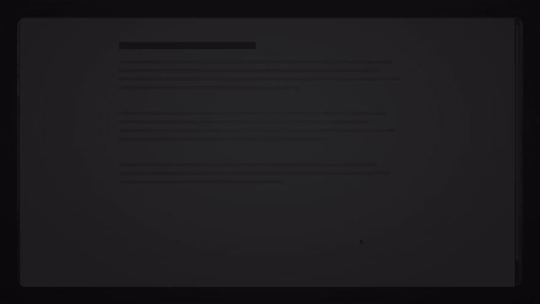
</p>

İsteğe bağlı, varsayılan olarak kapalı. Todoist'in sitesinden (*Settings › Integrations › Developer*) aldığınız kişisel API anahtarını *Ayarlar › Todoist* alanına yapıştırın. Houra görevlerinizi kendi görevlerinin yanında listeler, yeni oturumda seçtirir, oluşturup düzenleyebilir. Oturumun bitmesi Todoist görevini kendiliğinden tamamlamaz.

## Komutlar ve klavye

Çalışan Houra komut alır, bu yüzden her masaüstünde kısayola bağlanabilir. Flatpak'ta `houra` yerine `flatpak run io.github.fatihaydost.Houra` yazın.

```
houra newSession | panel | stats | tab <today|stats|sessions|categories|settings> | close | toggle | pause | finish
      closeSession | cancel | syncTodoist | style <tag|strip|capsule|card|ring|none> | status
```

`houra status` o anki durumu JSON olarak yazar.

Houra'nın içinde `Tab` ve ok tuşları gezdirir, `Enter` ya da `Space` seçer, `Delete` seçili öğeyi siler, `Esc` bir adım geri gider, sonra pencereyi kapatır.

## Verileriniz

- Oturumlar, görevler, kategoriler: `~/.local/share/houra/houra.sqlite`
- Ayarlar: `~/.config/houra/settings.json`
- Yalnız Todoist anahtarı: `~/.local/state/houra/todoist_token` (0600), komut satırına hiç yazılmaz

Todoist'i bağlamadıkça makinenizden hiçbir şey çıkmaz. *Ayarlar*'dan veri klasörünü açabilir, bütün oturumları CSV olarak dışa aktarabilirsiniz.

## Kaynaktan derleme

Flatpak'ı derleyin:

```sh
flatpak remote-add --user --if-not-exists flathub https://dl.flathub.org/repo/flathub.flatpakrepo
flatpak-builder --user --install --force-clean --install-deps-from=flathub \
  --state-dir ~/.cache/houra-fpbuild/state ~/.cache/houra-fpbuild/build io.github.fatihaydost.Houra.yml
```

Derleme klasörünü tmpfs üstünde tutmayın, `flatpak-builder` orada "Can't migrate locale dirs" hatası verir. AUR tarifi [`packaging/aur`](packaging/aur) klasöründe.

Paketlemeden çalıştırmak için Python 3.11+, **sistemin** PySide6 ve Qt 6 paketleri (Arch: `pyside6`; Debian/Ubuntu: `python3-pyside6.*`; Fedora: `python3-pyside6`) ve `layer-shell-qt` 6 gerekir. pip'teki PySide6 kendi Qt'sini getirdiği için sistemin layer-shell modülünü yükleyemez.

```sh
python3 -m houra
python3 -m houra --login on   # girişte başlat; `off` kaldırır
```

Testler:

```sh
python3 houra/backend/houra_cli.py --selftest
python3 -m unittest discover tests
QT_QPA_PLATFORM=offscreen python3 -m houra --smoke
```

Ekran görüntüleri ve kısa videolar uygulamanın kendisinden, örnek veriyle alındı. Videolar eski bir derlemede kaydedildi, renkler ve yazı tipi gördüğünüzden biraz farklı olabilir.

## Teşekkürler

- macOS sürümü, özgün fikir ve tasarım: [Emirhan (`@serbestonline`)](https://github.com/serbestonline) tarafından [**Houra**](https://github.com/serbestonline/Houra). Bu uyarlama onun MIT lisanslı sürümlerine dayanır.
- Uygulama simgesi: Houra'nın macOS sürümünden.
- Simgeler: [Phosphor Icons](https://phosphoricons.com) (MIT).
- Linux sürümü: [Fatih Aydost (`@fatihaydost`)](https://github.com/fatihaydost).

## Lisans

MIT, ayrıntı için [`LICENSE`](LICENSE).
